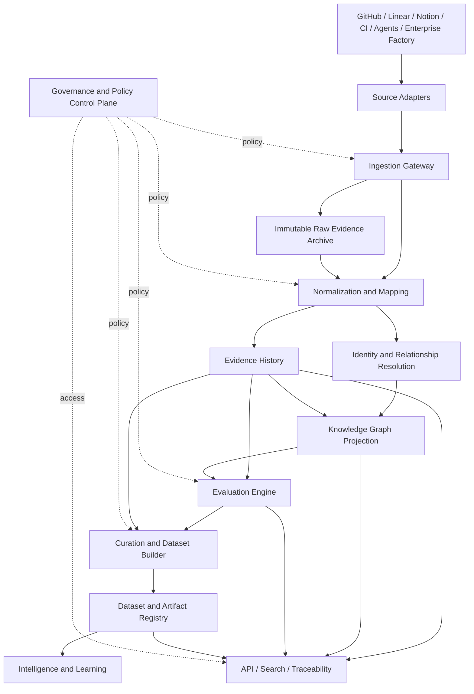

**Document status:** Architecture baseline proposal for review
**Work item:** SFI-02 — System Architecture and Enterprise Factory Integration Boundaries
**Project:** Software Factory Intelligence (Team SFI)
**Predecessor:** SFI-01 — Product Charter and Scope Baseline
**Repository:** mkrdiop/software-factory-intelligence

## 1. Purpose and architectural thesis

This specification translates the SFI-01 product charter into a logical system architecture, defines component responsibilities and trust boundaries, and establishes how SFI integrates with source engineering systems and the Enterprise Factory ecosystem.

**Architectural thesis:** SFI is a governed evidence-processing and intelligence platform placed alongside engineering systems. It observes and ingests authorized evidence, preserves its provenance and history, constructs traceable relationships, evaluates evidence, and publishes curated datasets and intelligence outputs. It does not replace the systems where engineering work is authored, approved, executed or released.

The architecture is deliberately technology-neutral at this stage. It defines logical responsibilities, data contracts, trust boundaries, flows and acceptance conditions. Storage engines, queues, graph technology, orchestration frameworks, deployment topology and specific protocol profiles require evidence-backed ADRs before selection.

## 2. Architecture goals

1. Capture engineering evidence across the complete lifecycle without requiring teams to abandon existing tools.
2. Preserve source fidelity, provenance, temporal history, permissions and tenant boundaries.
3. Connect intent, decisions, execution, validation, outcomes and learning through explicit, explainable relationships.
4. Separate raw/observed evidence from normalized records, derived assertions, evaluation results and curated datasets.
5. Support reproducible evaluation and immutable, versioned dataset releases.
6. Provide interoperable APIs and adapters without making one source vendor or agent framework authoritative.
7. Integrate with Enterprise Factory products by consuming and producing explicitly versioned evidence contracts while reusing shared standards.
8. Scale ingestion and data processing independently from interactive control-plane operations.
9. Make data governance and security enforceable throughout ingestion, query, evaluation, export and learning.

## 3. Architectural principles and constraints

- **Source systems remain authoritative:** SFI stores evidence copies and references, not replacement source-of-truth records.
- **Evidence before intelligence:** derived insights must link to their supporting evidence and transformation/evaluation version.
- **Append-only history:** corrections, retractions and changed source records are represented as new observations or supersession events; the system does not silently rewrite historical evidence.
- **Separate evidence from datasets:** a captured record is not automatically eligible for analytics, cross-tenant sharing, benchmarking or model training.
- **Governance follows the data:** permissions, rights, tenant ownership, classification and retention constraints travel with evidence and derived artifacts.
- **At-least-once ingestion, idempotent effects:** connectors must tolerate retries and duplicate delivery without creating duplicate logical observations.
- **Explicit uncertainty:** missing, inferred, conflicting and model-generated data must be distinguishable from source-observed facts.
- **Standards alignment:** SFI-specific schemas must not redefine Enterprise Factory shared semantics.
- **No premature technology lock-in:** choose technologies only through ADRs tied to measurable requirements.

## 4. System context and actors

### 4.1 External systems

- **GitHub and compatible source-control systems:** repositories, commits, branches, pull requests, reviews, releases and CI artifacts.
- **Linear and compatible work-management systems:** projects, issues, cycles, relationships, status transitions and acceptance records.
- **Notion and compatible knowledge systems:** product requirements, architecture documents, ADRs, specifications, meeting decisions and approved knowledge.
- **AI agents and development environments:** agent identity, task context, tool invocation summaries, proposed changes, execution traces and validation evidence, subject to explicit capture configuration.
- **CI/CD, testing, security and observability systems:** build/test outcomes, coverage, vulnerabilities, conformance reports, deployment events and operational outcomes.
- **Enterprise Factory products:** Studio, Connect, Runtime and Enterprise Factory Network, through explicit contracts and adapters.

### 4.2 Human actors

- Tenant administrators and data stewards configure sources, permissions, retention and dataset-use policies.
- Engineering leaders and architects inspect traceability, decisions and quality evidence.
- Developers and agents produce engineering activity and consume feedback.
- QA, security and reliability teams contribute validation and outcome evidence.
- Dataset curators review, label, exclude, approve and release curated datasets.
- SFI platform operators maintain service reliability without receiving unrestricted access to tenant content by default.

## 5. Logical architecture

SFI is divided into a control plane and an evidence/data plane. This is a logical separation; it does not require separate products or deployment clusters in the first release.

### 5.1 Control plane

1. **Tenant and workspace management** — tenant boundaries, workspaces, memberships, service identities and configuration.
2. **Source and connector management** — source registration, scopes, credentials references, webhook endpoints, sync schedules, cursor state and connector health.
3. **Governance and policy administration** — data classification, rights/consent, permitted purposes, retention, export rules and dataset approval policy.
4. **Schema and contract registry** — versioned SFI evidence, connector, evaluation and dataset contracts; references to authoritative external standards.
5. **Dataset and evaluation administration** — evaluation profiles, curation workflows, dataset versions, approval and publication.
6. **API and user-facing access** — authenticated query, search, traceability, evidence inspection, administration and export.

### 5.2 Evidence/data plane

1. **Connector workers** — source-specific API/webhook adapters and agent telemetry adapters. They acquire only configured scopes and preserve source identifiers and payloads.
2. **Ingestion gateway** — authenticates source deliveries, validates connector identity, assigns ingestion metadata, enforces size/rate limits and durably accepts envelopes.
3. **Raw evidence archive** — retains immutable source payload snapshots or protected payload references with content digests, source metadata and retention controls.
4. **Normalization and mapping pipeline** — maps source-specific representations into SFI evidence records while retaining original source semantics and field-level provenance where feasible.
5. **Identity and relationship resolver** — links records across systems using explicit source identifiers, verified mappings and explainable matching rules; uncertain matches remain unresolved candidates.
6. **Evidence history service** — stores normalized observations, revisions, provenance, temporal facts, supersession and retraction records.
7. **Knowledge graph projection** — maintains queryable relationships between evidence records; it is a derived projection of the evidence history, not a competing authority.
8. **Evaluation engine** — runs deterministic validators, traceability checks, policy checks and versioned evaluation profiles against fixed evidence snapshots.
9. **Curation and dataset builder** — applies approved filters, labels, transformations, exclusions and governance checks to create versioned dataset artifacts.
10. **Intelligence and learning workers** — perform approved analytics, pattern discovery, retrieval/index generation and permitted model/workflow evaluation.
11. **Artifact and dataset registry** — records immutable dataset/evaluation artifacts, manifests, digests, versions, lineage and access conditions.
12. **Observability and audit pipeline** — records operational telemetry and security/governance actions separately from tenant engineering content.

### 5.3 Logical flow

## 6. Component contracts and responsibilities

| Component | Owns | Must not own |
| --- | --- | --- |
| Connector | Source-specific acquisition, cursors, source IDs, mapping metadata | Global evidence semantics or dataset eligibility |
| Ingestion gateway | Delivery authentication, durable acceptance, idempotency keys, envelope validation | Source business meaning or trust decisions beyond connector authentication |
| Raw archive | Immutable captured payloads/snapshots, digests, retention metadata | Normalized cross-source relationships |
| Normalizer | Versioned mapping into SFI evidence contracts | Silent loss of source fields or invented facts |
| Resolver | Explicit links and confidence-scored candidate relationships | Irreversible identity merges based only on fuzzy similarity |
| Evidence history | Append-only observations, provenance, revisions and supersession | Curated training-data approval |
| Graph projection | Queryable nodes/edges and projection version | Independent authoritative facts that cannot be traced to evidence |
| Evaluation engine | Reproducible results, rule/profile versions and evidence references | Unverifiable claims or implicit changes to source records |
| Dataset builder | Inclusion/exclusion, curation, labels, transformations and lineage | Bypassing governance or silently mutating published datasets |
| Artifact registry | Immutable artifact versions, digests, manifests and access metadata | Rewriting an existing released artifact |
| Governance plane | Policies, consent/rights, classification, access and retention decisions | Overriding source-system authority or granting itself unrestricted content access |

## 7. Evidence lifecycle and trust levels

Every captured item must be classifiable by how it was obtained and transformed. At minimum, SFI distinguishes:

1. **Source-observed:** directly returned by a source system or signed/identified source delivery.
2. **Source-derived:** a value computed by a source system, such as a test summary or review state.
3. **SFI-normalized:** a source representation mapped into a versioned SFI contract.
4. **SFI-derived:** a relationship, metric, summary or assertion computed by SFI.
5. **Model-generated:** content proposed by a model or agent, with model/tool/version and input lineage where available.
6. **Human-verified:** an explicit review or approval attributable to an authenticated actor.

These labels are not a single linear trust ranking. A human-approved model suggestion remains model-generated in origin and separately records its human review state. A test result is source-derived evidence, not proof that the tested system is correct in every context.

### 7.1 Minimum provenance envelope

SFI-03 will define the canonical schema. SFI-02 requires the following information to be represented where applicable:

- SFI evidence record identifier and schema version.
- Tenant/workspace scope and data classification.
- Source system, connector identity and connector version.
- Source object type, stable source object identifier and source URL/reference.
- Source event time, source update/version marker, SFI observed time and ingestion time.
- Original payload or protected immutable payload reference and cryptographic digest.
- Normalization/mapping version and transformation lineage.
- Actor/principal identity as asserted by the source, with identity confidence and namespace.
- Evidence origin/trust category and whether a value is observed, derived, inferred or model-generated.
- Ownership, rights/consent basis, permitted purposes and applicable policy version.
- Retention class, deletion/restriction state and source deletion/retraction status.
- Links to predecessor, successor, superseded or related evidence records.

Missing fields must be explicitly absent/unknown rather than populated with invented defaults.

### 7.2 Temporal model

SFI must distinguish at least:

- **Event time:** when the source says the event occurred.
- **Observed time:** when SFI first observed the event or source state.
- **Ingested time:** when SFI durably accepted the envelope.
- **Effective/version time:** the source version or validity interval where the source provides one.

Late-arriving and out-of-order events are expected. SFI must preserve both source order/version evidence and ingestion order; it must not infer event chronology solely from arrival order.

## 8. Evidence history, graph and dataset separation

### 8.1 Engineering Evidence History

The evidence history is the durable historical record. It is append-only from the application perspective. Corrections, redactions, source deletions, mapping corrections and policy changes are recorded as explicit events or state transitions. Physical deletion may still be required by law, contract or retention policy; the architecture must support controlled deletion or cryptographic erasure while retaining only legally permitted audit evidence.

### 8.2 Knowledge graph

The graph is a derived relationship index over evidence records. Example relationships include:

- requirement **satisfied\_by** implementation change;
- decision **constrains** requirement or architecture;
- issue **implemented\_by** pull request;
- commit **validated\_by** test run;
- release **contains** commit or artifact;
- incident **associated\_with** deployment;
- evaluation **evaluates** evidence snapshot;
- dataset example **derived\_from** evidence records.

Every edge must carry provenance, method, confidence (when inferred), creation/version metadata and the evidence supporting it. A graph edge must be retractable or supersedable without destroying its historical record. Ambiguous matches remain candidate edges until resolved.

### 8.3 Software Engineering Intelligence Dataset

A dataset is a released, immutable selection and transformation of evidence for a declared purpose. Every dataset release must identify:

- dataset identity and version;
- intended use and prohibited uses;
- source evidence snapshot/cutoff and inclusion/exclusion rules;
- tenant/ownership scope and rights/permission evaluation;
- schema, transformation, label and evaluation versions;
- lineage to raw and normalized evidence;
- quality checks, review/approval state and known limitations;
- artifact digest, publication timestamp and retention/revocation policy.

Published dataset versions are immutable. A correction or changed curation rule produces a new version. A dataset release can be revoked or access-restricted without silently rewriting its historical manifest.

## 9. Enterprise Factory integration boundaries

### 9.1 Authority model

The Enterprise Factory Specification (EFS), canonical Factory Manifest object model, shared glossary and associated conformance artifacts remain authoritative in the Enterprise Factory project and its repositories. SFI consumes these standards by reference and may define SFI-specific evidence contracts only in an SFI namespace.

Relevant authoritative references:

- <mention url="https://app.notion.com/p/41af741d6511814186e7cdc2ada67a80">Enterprise Factory — Architecture Overview</mention>
- <mention url="https://app.notion.com/p/41af741d651181ee87d5e868b6167d54">Enterprise Factory Specification (EFS) — v1 Baseline</mention>
- <mention url="https://app.notion.com/p/41af741d651181ac9488d932f13051f0">EFS v1 — Canonical Factory Manifest Object Model</mention>
- <mention url="https://app.notion.com/p/41af741d651181149c64c75fba1a8b6d">EFS Glossary & Domain Map</mention>

### 9.2 Non-negotiable identity and semantic rules

- SFI must not create its own publisher identity format, URI normalization rules, aliasing or identity transfer semantics.
- Where SFI records an EFS publisher identifier, it treats `publisher.id` as the exact opaque absolute URI defined by EFS and delegates validation/comparison to the authoritative EFS conformance implementation.
- EFS identity processing is local-only: SFI must not dereference publisher URIs, resolve DNS, follow redirects or perform key discovery as part of identity comparison.
- SFI must keep Publisher Identity, Factory Identity and Execution Identity distinct. A source-system user, tenant, agent or connector identity is not automatically an EFS publisher or execution identity.
- SFI must not reinterpret EFS manifest fields, release digests, capability contracts, execution profiles, policies or lifecycle semantics.
- EFS schema validity, semantic validity, policy/trust verification and runtime support remain distinct states; SFI must not collapse them into a single “valid” or “trusted” flag.

### 9.3 Product integration matrix

| Enterprise Factory product | Authoritative responsibility | SFI integration responsibility |
| --- | --- | --- |
| Factory Studio | Authoring, editing, validating and packaging manifests/contracts | Consume authorized specification revisions, validation evidence, authoring decisions and package/release references |
| Factory Connect | Connector configuration, credentials boundary, external adapters and mapping | Consume connector configuration metadata and authorized integration/health evidence; never ingest secret values |
| Factory Runtime | Admission, execution orchestration, state transitions, policy enforcement and telemetry | Consume run correlation, lifecycle events, validation outcomes, policy decision references and operational evidence |
| Enterprise Factory Network | Publisher identity, registry/catalog, discovery, distribution and composition | Consume published release metadata, immutable artifact references, conformance/verification evidence and discovery events |

SFI may return evidence summaries, traceability reports, evaluation results or dataset references through explicit APIs. These outputs do not mutate EFS manifests, registry identity records, published releases or runtime state.

### 9.4 Integration pattern

The preferred pattern is event/record exchange through versioned adapters:

- Enterprise Factory products emit authorized, correlated lifecycle and conformance evidence.
- SFI ingests and maps the evidence into SFI evidence contracts while retaining source references and source semantics.
- SFI publishes derived evidence and dataset references through documented SFI APIs or export contracts.
- Any future write-back or control action must be a separately authorized integration with a dedicated contract, least-privilege scope, audit trail and human approval where consequential.

No direct database sharing or undocumented internal API dependency is permitted as an integration contract.

## 10. External source integration model

### 10.1 Initial source adapters

The first connector wave is GitHub, Linear, Notion and agent activity, as established by SFI-01. CI/test/security/observability and Enterprise Factory product adapters follow when their evidence contracts and permissions are defined.

Each connector must declare:

- source type and supported API/version/profile;
- requested permission scopes and reason;
- object/event coverage and known omissions;
- polling, webhook or snapshot strategy;
- cursor/checkpoint and replay behavior;
- rate-limit and retry behavior;
- source identity mapping strategy;
- deletion/retraction handling;
- mapping contract version;
- health and lag metrics.

### 10.2 Acquisition modes

- **Webhook/event:** low-latency notifications where the source supports reliable delivery; notifications may trigger a source re-fetch to obtain canonical current state.
- **Polling/incremental sync:** cursor-based retrieval for updates and missed webhook recovery.
- **Snapshot/backfill:** bounded historical import with explicit cutoff, source scope and backfill job identity.
- **Agent instrumentation:** explicit SDK, callback or adapter integration that captures configured activity; never assume complete visibility into hidden model reasoning or private chain-of-thought.

Connectors must support replay from a known cursor or snapshot boundary. Webhook delivery alone is not a complete source-of-truth history.

### 10.3 Initial connector posture

Initial connectors are read-only with respect to source engineering records. SFI may create its own connector registration, webhook endpoint, comments-free evidence references and internal job state, but it must not create, update, close, approve or merge source records as a side effect of ingestion.

## 11. API and interoperability boundaries

SFI exposes versioned interfaces for:

- connector registration/configuration and health;
- evidence ingestion (event and batch);
- evidence retrieval and source-reference resolution;
- traceability graph queries;
- evaluation execution and result retrieval;
- dataset curation, approval, release and artifact retrieval;
- audit and governance administration.

Interface requirements:

- explicit API/contract versioning and compatibility policy;
- authenticated tenant context and authorization on every request;
- idempotency keys for ingestion and retried mutations;
- correlation IDs across connector, ingestion, processing and evaluation;
- pagination, bounded queries and export limits;
- explicit error types and retryability;
- no secrets in payloads, logs or exported evidence;
- machine-readable schemas and conformance tests.

OpenAPI, CloudEvents, MCP and A2A may be evaluated as adapter/interface profiles. None is selected as the universal internal SFI contract by this specification. External protocol semantics must map through explicit, tested adapters.

## 12. Security, privacy and governance architecture

### 12.1 Trust boundaries

1. External source to connector: authenticate source/webhook delivery and validate source identity.
2. Connector to ingestion gateway: authenticate connector service identity; enforce tenant binding and connector scopes.
3. Ingestion to processing: treat all source payloads as untrusted data; validate size, type and content; prevent prompt injection or embedded instructions from being interpreted as system policy.
4. Processing to evidence stores: enforce tenant isolation and write authorization; preserve provenance and immutable digests.
5. Query/API to user: authorize every object and relationship traversal; prevent cross-tenant inference through search, graph edges, caches or exports.
6. Dataset builder to artifact registry: enforce permitted purpose, ownership, rights, approval and lineage before publication.
7. SFI operator to tenant data: privileged access is time-bounded, attributable and minimized; operational support does not imply unrestricted content access.

### 12.2 Governance controls

- Tenant/workspace isolation at identity, query, storage, cache, graph, job and export layers.
- Least-privilege source scopes and separate connector credentials per tenant/source where feasible.
- Encryption in transit and at rest; managed secret storage and key rotation.
- Data classification and retention policies by evidence category.
- Consent/contract/rights metadata and permitted-purpose checks at ingestion and dataset publication.
- Deletion, restriction, export and legal-hold workflows with auditable outcomes.
- Dataset release approval and explicit model-training permission, not inferred from general analytics permission.
- Audit trails for access to sensitive evidence, policy changes, dataset release and privileged operations.
- Content sanitization and safe rendering for untrusted source text and attachments.
- No ingestion or storage of passwords, private keys, access tokens or source credentials as evidence payloads; redact or reject them at the connector boundary.

### 12.3 Model and agent safety

Source content, code, issues, documents and agent traces are untrusted inputs. They must never override SFI system instructions, connector policy, tenant permissions or dataset governance. Model-generated summaries, labels and relationship proposals are derived evidence and must include model/version, prompt or evaluation profile reference where retained, input lineage and confidence/review state. Hidden model reasoning is neither required nor assumed to be captured.

## 13. Reliability, consistency and recovery

- Ingestion uses durable acceptance before acknowledging delivery.
- Duplicate source deliveries are expected; idempotency is based on source identity/version plus connector/tenant scope, with a fallback envelope key.
- Processing is retryable and checkpointed; failed records are quarantined with reason and replay controls.
- Backfills are bounded, observable and resumable.
- Out-of-order events do not overwrite newer source versions without version-aware reconciliation.
- Connector outages create visible lag and health degradation, not silent data loss.
- Reconciliation jobs compare source snapshots/cursors with captured evidence to detect gaps where APIs permit.
- Graph projections and search indexes are rebuildable from authoritative evidence history and versioned transformation code.
- Dataset artifacts are reproducible from pinned source snapshots, mapping versions, curation rules and evaluator versions, subject to retention/rights constraints.
- Backups, restore testing, disaster recovery and regional data residency requirements must be specified before production deployment.

## 14. Observability and operational measures

SFI must measure, at minimum:

- connector health, last successful sync, lag, cursor age and rate-limit events;
- accepted, rejected, duplicate, delayed and quarantined ingestion envelopes;
- normalization success/failure by connector and mapping version;
- provenance completeness and unresolved identity/relationship rates;
- evidence-to-graph projection lag and rebuild status;
- evaluation duration, failure rate and reproducibility;
- dataset build duration, quality outcomes, approval time and release integrity;
- authorization denials, cross-tenant access test failures and governance exceptions;
- service availability, queue depth, processing throughput and recovery time.

SFI-03 through SFI-05 will define canonical metric formulas and initial target values. This architecture does not invent numerical SLOs before workloads and baselines are measured.

## 15. Deployment and technology decision boundary

The reference deployment separates:

- interactive control-plane APIs and administration;
- connector/ingestion workers;
- normalization and relationship-processing workers;
- evaluation and dataset-building workers;
- artifact storage and query/index services.

A modular monolith control plane with independently scalable workers is a reasonable initial deployment hypothesis. It is not an approved technology or topology decision. A single deployable may contain multiple logical modules initially, provided module contracts and tenant boundaries are testable. Extraction into services should be driven by isolation, scaling, availability or independent-release requirements.

The following choices remain open and require ADRs:

- relational metadata store and transaction model;
- immutable object/archive storage and digest layout;
- graph storage versus relational graph projection;
- search/index technology;
- event broker and workflow orchestration;
- connector runtime isolation and secret management;
- API framework and protocol profiles;
- tenant isolation tiering and deployment regions;
- encryption/key management and retention/erasure design;
- model provider, inference isolation and evaluation tooling.

## 16. Failure modes and architectural responses

| Failure mode | Required response |
| --- | --- |
| Source API unavailable or rate-limited | Backoff, preserve cursor, expose lag, resume without data loss |
| Webhook duplicated or reordered | Idempotent acceptance and version-aware reconciliation |
| Malformed or hostile payload | Quarantine, sanitize, retain safe diagnostic metadata and prevent execution |
| Normalizer regression | Version mappings, retain raw evidence, replay into a new derived version |
| Incorrect identity match | Keep candidate link, require evidence/review, support supersession |
| Tenant policy changes | Re-evaluate access and dataset eligibility; restrict affected derived artifacts |
| Source record deleted or access revoked | Record deletion/restriction event and apply retention/legal policy to raw and derived artifacts |
| Graph index corruption | Rebuild from evidence history and pinned projection version |
| Dataset quality failure | Block release; preserve failed build and diagnostics |
| Dataset rights failure | Block export/publication/training use; quarantine or exclude affected records |
| SFI control-plane outage | Durable workers and queues continue only within defined lease/policy; recover idempotently |
| Cross-tenant authorization defect | Fail closed, alert, audit, contain and initiate incident response |

## 17. Architecture decision register

This specification establishes boundaries but intentionally does not prematurely choose infrastructure. The following ADRs are recommended before production implementation:

- **SFI-ADR-001 — Evidence persistence and immutable raw archive:** storage boundaries, digest strategy, correction/deletion and retention.
- **SFI-ADR-002 — Ingestion delivery and processing semantics:** queue/event model, idempotency, replay, ordering and backpressure.
- **SFI-ADR-003 — Evidence graph and relationship resolution:** graph representation, confidence, provenance and merge/retraction.
- **SFI-ADR-004 — Tenant isolation and governance enforcement:** isolation tiers, keys, access policy, operator access and residency.
- **SFI-ADR-005 — Dataset artifact format and registry:** packaging, manifest, immutable release, lineage and revocation.
- **SFI-ADR-006 — API and connector protocol profiles:** REST/event contracts, webhook security and version negotiation.
- **SFI-ADR-007 — Deployment topology and operational scaling:** modular monolith boundaries, worker isolation and extraction criteria.
- **SFI-ADR-008 — Model/agent evidence capture and evaluation safety:** capture scope, prompt injection controls, model metadata and permitted uses.

These are proposed SFI-specific decisions. They must not alter Enterprise Factory shared standards.

## 18. SFI-02 acceptance criteria

- [ ] System context, actors, external systems and logical control/data planes are defined.
- [ ] Component responsibilities and ownership boundaries are explicit.
- [ ] Evidence lifecycle, provenance envelope, temporal semantics and trust categories are specified at architecture level.
- [ ] Evidence history, knowledge graph, evaluation results and curated datasets are distinct assets with traceable lineage.
- [ ] Enterprise Factory integration responsibilities are mapped for Studio, Connect, Runtime and Network.
- [ ] EFS authority, publisher identity handling and shared-standard non-duplication constraints are explicit.
- [ ] Initial source connector modes and read-only posture are defined.
- [ ] API/interoperability requirements are documented without prematurely selecting a universal protocol.
- [ ] Security, privacy, tenant isolation, retention, rights and model-safety boundaries are documented.
- [ ] Reliability, recovery, observability and failure modes are specified.
- [ ] Technology choices are separated from logical architecture and assigned to ADRs.
- [ ] The architecture specification is saved in the SFI Notion knowledge hub, versioned in the SFI GitHub repository and tracked by an SFI Linear issue.

## 19. Dependencies and next specifications

- **SFI-03 — Canonical Engineering Evidence and Dataset Model:** define normative SFI object schemas, provenance envelope, temporal fields, identity/link model, dataset manifest, versioning and compatibility.
- **SFI-04 — Evidence Capture Strategy:** define concrete GitHub, Linear, Notion and agent connector scopes, source mapping and sync/replay behavior.
- **SFI-05 — Dataset Curation, Provenance and Quality Framework:** define dataset eligibility gates, rights checks, quality dimensions, labeling, review, reproducibility and release policy.

SFI-03 is the immediate next dependency. Connector implementation should not begin before its evidence contract and governance fields are sufficiently stable.

## 20. Change control

This is an architecture baseline proposal for review, not an approval of specific infrastructure products or deployment technologies. Changes to logical responsibilities, trust boundaries, evidence semantics or Enterprise Factory integration contracts require an explicit decision and corresponding updates to this document and affected contracts. Decisions that affect EFS or another shared Enterprise Factory standard must be proposed in that standard's authoritative project and repository, not decided unilaterally in SFI.